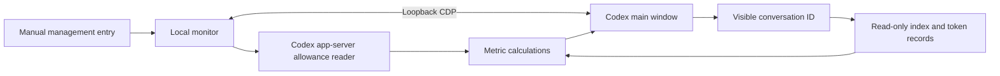

# Codex Status Bar Technical Design

- Version: v1.0, confirmed
- Requirements: [spec.md v1.1](spec.md)
- Current stage: task plan confirmed; implementation feasibility checks in progress
- Investigation date: 2026-10-29
- Approval: user explicitly confirmed design.md and requested tasks.md

## 1. Approach

Use a Node.js 24 local helper to manage runtime state and connect to the Codex main window through loopback Chrome DevTools Protocol (CDP). Add three SVG rings to the window's top bar. Read allowance through a separate Codex CLI app-server connection. Identify the visible conversation, resolve its local record through the conversation index, and read its latest valid token statistics.

Reuse the reference project's connection approach while independently implementing top-bar placement and context reads. Use the Node.js standard library, built-in WebSocket, fetch, and node:sqlite, with no third-party runtime dependencies.

This project retains separate design and task reviews as explicitly requested. Live verification remains part of authorized implementation and acceptance work; confirming the design does not claim that pending integration checks have passed.

## 2. Local Evidence and Verification Boundaries

| Area | Observed evidence | Status |
| --- | --- | --- |
| Client | Running executable belongs to the OpenAI.Codex_26.1007.2314.0 Windows installation | Observed; other versions unverified |
| Node.js | System PATH provides v20.12.0; the Codex companion runtime provides v24.19.0 | Reuse existing Node.js 24 |
| CLI | Managed codex-cli 0.162.0-alpha.17.2 executes and supports app-server over stdio | Command help checked; independent allowance reads pending |
| Account allowance | This chat successfully read 300-minute and 10080-minute windows | Data exists; standalone login consistency pending |
| Context calculation | Local app-primary code divides last.totalTokens by modelContextWindow to calculate used percentage | Native formula verified through read-only inspection |
| Conversation index | The local state_5.sqlite threads table contains id and rollout_path; Node.js 24 opens it read-only | Schema verified |
| Conversation records | The current conversation's JSONL includes token_count, last_token_usage, and model_context_window | Fields verified |
| Conversation route | Local frontend code includes /local/:conversationId and active-page markers | Static evidence verified; visible-page identification pending |
| Top bar | Local frontend code includes data-window-titlebar and data-app-shell-titlebar-content | Static evidence verified; live position and available space pending |
| CDP | No usable debugging connection was found on local port 39222 | Debug startup and reconnection unverified |

The application package was inspected read-only. Static evidence applies to the observed installation and does not replace runtime acceptance. Task planning places window connection, active-conversation identification, and layout feasibility first. Return to requirements or design review if those checks affect approved behavior.

## 3. Responsibilities and Proposed Files

| Proposed file | Responsibility |
| --- | --- |
| manage.ps1 | Discover existing Node.js 24 and provide a manual management entry |
| manage.cjs | Start, query status, stop, and enforce a single instance |
| agent.cjs | Coordinate CDP, scheduling, data sources, and shutdown |
| codex-data.cjs | Handle app-server requests and notifications, index queries, and incremental token-record reads |
| renderer.js | Identify the visible conversation, mount the top-bar component, render SVG, and remove owned UI |
| metrics.cjs | Calculate remaining percentages, validity, and colors |

Resolve project files relative to the scripts. Store runtime state and necessary error logs in Git-ignored `.runtime/`. Log operational stages and sanitized error categories in English. Codex continues to own login state and conversation storage.

## 4. Data Sources and Calculations

### 4.1. Account Allowance

- Start an executable Codex CLI with `app-server --stdio`, complete initialize and initialized, then call `account/rateLimits/read`.
- Use the current user's existing Codex login environment. Match the desktop account and CODEX_HOME, and compare returned allowance during integration.
- Prefer `rateLimitsByLimitId.codex`. Fall back to compatible `rateLimits` only when that key is absent and its limitId identifies Codex.
- Identify 300-minute and 10080-minute windows by windowDurationMins, inspecting both primary and secondary.
- Calculate raw remaining percentage as `clamp(100 - usedPercent, 0, 100)`. Valid input must be a finite number. Missing windows or read failures make only the affected metric unavailable.
- Read immediately after connection and every 60 seconds thereafter. Merge `account/rateLimits/updated` notifications, preserving untouched fields and treating explicitly cleared fields as unavailable.
- Clear old allowance on account updates before rereading. Retry failed reads without showing previous-account values.
- Use a 10-second request timeout and retry every 10 seconds after failure. Serialize active reads and retries to prevent overlapping requests.

Codex handles authenticated network requests. The helper uses the CLI account interface and leaves credentials within the existing login mechanism.

### 4.2. Visible Conversation

- Read the active page's local-conversation route in the target window and extract its exact conversationId. Use active-page and route markers rather than titles, modification times, or background execution state.
- `/local/:conversationId` is the known route for the observed version. Active pages may have separate containers; verify that the selected route matches the visible conversation instead of assuming window.location always represents it.
- Observe page and route changes, supplemented by a 1-second check. Return unavailable when multiple candidates cannot be resolved to one visible page.
- Clear context when selection changes and increment a selection generation. Apply asynchronous results only when both conversation ID and generation still match.
- Return unavailable on home, new-conversation, cloud-conversation, or otherwise unmappable pages. The first release supports local Codex conversations with readable token records.

### 4.3. Context Records

- Discover the local state database under CODEX_HOME or the current user's default `.codex` directory. Select a current schema containing the required threads fields and open it read-only with node:sqlite.
- Execute only the parameterized lookup `SELECT rollout_path FROM threads WHERE id = ?`. Preserve database schema and records.
- Read only the selected conversation's JSONL file and verify that its session ID matches. Retain token counts, window capacity, and freshness metadata; skip and discard unrelated records.
- Scan the target file in chunks initially. Check for additions every second and read incrementally by offset. Buffer incomplete trailing lines and reset reading state if the file is truncated or replaced.
- Use the latest valid token_count fields `info.last_token_usage.total_tokens` and `info.model_context_window`. Capacity must be positive and finite, and usage nonnegative and finite.
- Calculate raw context remaining as `100 * (1 - min(lastTotalTokens, modelContextWindow) / modelContextWindow)`. This complements the native frontend's verified used-context formula.
- Use the recent-usage fields rather than the cumulative `total_token_usage` or threads.tokens_used values.
- On a newer compaction marker or model-context change without corresponding new statistics, temporarily mark context unavailable. Restore it after valid new statistics arrive.
- Preserve the user's conversation state: do not resume, modify, or start conversations for monitoring. A separate allowance app-server connection must not be assumed to receive all desktop-thread token notifications.

Record persistence may lag native state. Display the latest obtainable valid statistics, and compare native values, record timestamps, and display timestamps during acceptance. Revisit the design if the 5-second requirement cannot be met.

## 5. Top Bar and Rings

### 5.1. Mounting and Centering

- Connect to `127.0.0.1:39222` over CDP and select only the Codex main-window page target. Validate the WebSocket protocol, loopback host, and expected port before connecting.
- Locate the visible top bar using the observed markers. Use its vertical position and the entire window width to calculate the center. Mount an independently owned DOM container.
- Use fixed positioning. ResizeObserver and window resize events maintain placement; MutationObserver detects top-bar replacement and remounts the component.
- Deduplicate through a stable project-owned container ID and scoped styles. Reconnection updates an existing owned component.
- Keep rings noninteractive by default to preserve pointer and drag behavior. Check for overlap with existing visible controls before rendering. Report incompatible placement while preserving existing controls, then return to design review.
- Measure actual window sizes and scaling during initial integration. Record the supported minimum size from observed behavior rather than treating static selectors as an AC-02 pass.

### 5.2. Visual Parameters

| Parameter | Design value |
| --- | --- |
| Order | 5h, Weekly, Context from left to right, centered as a group |
| Ring diameter | Initially 32 CSS px with a 3 CSS px stroke, checked against actual top-bar height |
| Percentage | Rounded integer including the percent sign, centered and using the theme's normal foreground color |
| Labels | Short English labels outside the rings |
| Progress | Clockwise from the top, based on raw remaining percentage |
| Color | HSL hue equals raw remaining percentage times 1.2, with 75% saturation and 45% lightness |
| Color endpoints | Green at 120 degrees for 100%, yellow at 60 degrees for 50%, red at 0 degrees for 0% |
| Unavailable | Neutral gray ring with --, distinguishable from valid red 0% |

Use integer rounding only for the central text. Arc length and color share the same raw value. At 0%, the progress arc has zero length, while a red status marker and central 0% remain visible. Theme changes update track and text colors. Verify readability at normal font size before finalizing visual measurements.

## 6. Lifecycle

- Discover existing Node.js 24 and verify its version and node:sqlite capability. Preserve system Node.js 20; discover the companion runtime from existing installation locations.
- Discover the client and CLI from current processes, installation information, and managed CLI locations. Avoid fixed version directories in implementation. Direct execution of the WindowsApps CLI was denied in the current sandbox, so prefer the already executable managed CLI.
- On start, check the tool-owned named-pipe control endpoint. Return existing status if an instance is already running.
- Attach when compatible CDP is already enabled. If Codex is running without CDP, ask the user to save work and quit voluntarily before using the startup entry. Preserve the active session.
- Launch a new client with loopback debugging arguments only. Hide background monitor consoles. Verify that the installed client actually accepts those arguments.
- Derive the named pipe from the user and project location for single-instance ownership, status, and stop. Manage only child processes created by the helper.
- Status reports runtime stage, connection, placement, metric availability, and update times, keeping account identifiers and credentials private by default.
- Stop removes the UI, cancels timers and observers, closes CDP, ends the owned allowance app-server, and exits the monitor while leaving Codex open.
- Stopping the monitor may leave the client's debugging port active. Fully quitting Codex and reopening through its original icon restores ordinary startup. Document this in the final README.
- On temporary CDP loss, clear data state and retry. Exit the monitor when Codex closes. After reconnection, rediscover the active page and reread metrics.

## 7. Permissions, Privacy, and Reuse

- CDP can execute window scripts and has privileges beyond the three displayed metrics. Use loopback only, keep the port inaccessible externally, and explain this runtime condition in the final README.
- Use existing login through the CLI. Open the index and target records read-only, keep credentials and message bodies out of logs, and keep operational data local.
- Limit database lookup to the current conversation's record path. Extract token metadata while reading JSONL and discard unrelated content. Codex retains responsibility for its original conversation storage.
- Independently implement the first release while referencing the upstream approach. Before directly copying upstream code, verify its source and preserve applicable MIT license and copyright notices.
- Implement only the three confirmed metrics. The reference Windows draft's reset-card endpoint is outside this project's scope.

## 8. Verification and Review Gates

| Area | Verification | Acceptance criteria |
| --- | --- | --- |
| Percentage and quota windows | Synthetic inputs for 300/10080-minute selection, missing values, and rounding | AC-03, AC-08 |
| Context semantics | Native formula comparison and sanitized token values, including latest statistics, compaction, and model changes | AC-04, AC-06 |
| Switching races | Alternate between conversations with different usage and discard old asynchronous results | AC-05 |
| Ring appearance | Check 100%, 75%, 50%, 25%, 0%, and unavailable states | AC-01, AC-11, AC-12 |
| Layout | Check local window sizes, scaling, themes, scrolling, and existing controls | AC-02 |
| Refresh and recovery | Compare sanitized timestamps for 60-second allowance and 5-second context timing, then exercise a single-source failure and recovery | AC-06, AC-07, AC-08 |
| Process cleanup | Repeat start, stop, and reconnect while checking one component and owned-child exit | AC-09 |
| Privacy and file boundaries | Review outputs and modification lists for preserved application, login, and index state | AC-10 |

Design investigation is complete, and implementation has begun. The first standalone allowance probe passed; see tasks.md for current evidence. Runtime acceptance remains pending. Live CDP verification requires the user to save work and reopen Codex voluntarily during an authorized verification step.

The user has confirmed this design and the task plan, authorizing implementation. Follow the task plan's live feasibility gate before proceeding to metric and ring implementation. Return to design review if initial checks cannot establish page identity, top-bar space, or account consistency.

## 9. References and Review History

- [Official OpenAI App Server documentation](https://learn.chatgpt.com/docs/app-server): allowance requests, allowance notifications, and thread token updates
- [Codex Usage Card](https://github.com/Lorie7813/codex-usage-card): the local app-server and CDP approach
- Read-only local package inspection: app-primary context formula, app-shared window markers and routes, and thread-app-shell-chrome top-bar markers
- Read-only Node.js 24 database-schema inspection and current-conversation token metadata checks

| Version | Status | Notes |
| --- | --- | --- |
| v0.1 | Confirmed | User explicitly confirmed design.md and requested tasks.md |
| v1.0 | English baseline | Translated the confirmed approach into English and recorded approval; runtime checks remain pending |
